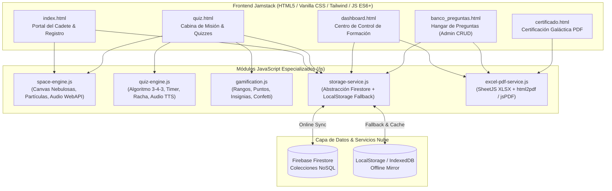
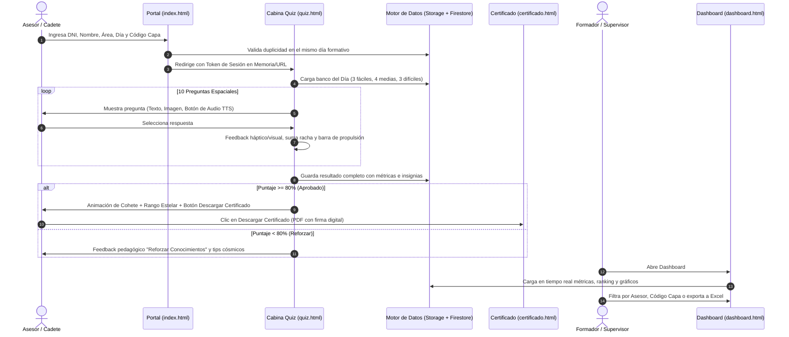

# 🚀 MISIÓN WINNER - NOVA FIDELIZ - QUIZZES
## Documento Maestro de Arquitectura Técnica, Modelo de Datos, UX/UI y Roadmap

---

### 1. Visión del Producto y Objetivos Estratégicos

**MISIÓN WINNER - NOVA FIDELIZ - QUIZZES** es un ecosistema web gamificado de alta tecnología diseñado para evaluar, acompañar y potenciar el aprendizaje de nuevos asesores en su curva de inducción formativa. Mediante una narrativa inmersiva de exploración interplanetaria ("Academia Galáctica WINNER"), la plataforma transforma las evaluaciones tradicionales en misiones espaciales estimulantes, eliminando el estrés de las pruebas y aumentando la retención de conocimientos operativos y de servicio.

#### Objetivos Clave:
1. **Cero fricción de acceso:** Sin gestión de usuarios ni contraseñas complejas. Identificación ágil mediante DNI, Nombre, Área, Código de Capacitación y Día Formativo.
2. **Evaluación adaptativa y balanceada:** Algoritmo generador que extrae 10 preguntas balanceadas (3 Cadete/Fácil, 4 Piloto/Medio, 3 Comandante/Difícil) garantizando aleatoriedad sin duplicados.
3. **Multisensorialidad y Accesibilidad:** Soporte para preguntas con imágenes y locución por audio (Text-to-Speech nativo + soporte de audio MP3) para entrenamiento inclusivo y dinámico.
4. **Almacenamiento Híbrido Resiliente:** Integración nativa con **Firebase Firestore** para sincronización en tiempo real en la nube, con capa de persistencia y contingencia automática (LocalStorage/IndexedDB) para operar sin interrupciones incluso offline o sin credenciales previas.
5. **Analítica de Alto Impacto:** Dashboard directivo con KPIs en tiempo real, evolutivo histórico por asesor, gráficos Chart.js y exportación avanzada a Excel/PDF.
6. **Reconocimiento Inmediato:** Emisión instantánea de Certificados de Honor Espacial con sellos holográficos y descarga en PDF vectorial para aprobados (≥ 80%).

---

### 2. Arquitectura Técnica Global



---

### 3. Modelo de Datos Firestore (NoSQL Schema)

La base de datos se estructurará bajo un diseño optimizado para lecturas rápidas, agregaciones eficientes y consultas por asesor y fecha.

#### Colección: `evaluaciones` (Resultados de Quizzes)
Identificador: Auto-ID o `${dni}_${dia}_${timestamp}`
```json
{
  "id": "eval_74829103_dia1_1727546400000",
  "participante": {
    "nombreCompleto": "Carlos Mendoza Ruiz",
    "dni": "74829103",
    "area": "Fidelización Call",
    "codigoCapa": "CAPA-2026-09",
    "avatar": "astronaut_helios"
  },
  "sesion": {
    "dia": "Día 1",
    "diaNumero": 1,
    "fechaRegistro": "2026-09-28",
    "timestamp": 1727546400000,
    "tiempoTotalSegundos": 284
  },
  "metricas": {
    "puntaje": 90,
    "puntajeSobre20": 18,
    "porcentaje": 90,
    "aciertos": 9,
    "errores": 1,
    "estado": "APROBADO", // "APROBADO" | "REFORZAR CONOCIMIENTOS"
    "aprobado": true
  },
  "gamificacion": {
    "rango": "Leyenda del Universo WINNER",
    "rangoId": "leyenda",
    "insigniasGanadas": [
      "primer_despegue",
      "navegante_espacial"
    ],
    "rachaAciertosMax": 5
  },
  "respuestasDetalle": [
    {
      "preguntaId": "preg_d1_001",
      "enunciado": "¿Cuál es el protocolo de saludo oficial WINNER?",
      "nivel": 1,
      "categoria": "Protocolo",
      "opcionSeleccionada": 2,
      "opcionCorrecta": 2,
      "esCorrecta": true,
      "tiempoRespuestaSegundos": 14
    }
  ]
}
```

#### Colección: `banco_preguntas`
```json
{
  "id": "preg_d1_005",
  "dia": "Día 1",
  "diaNumero": 1,
  "categoria": "Protocolo y Objeciones",
  "nivel": 2, // 1: Cadete (Fácil), 2: Piloto (Medio), 3: Comandante (Difícil)
  "nivelLabel": "Piloto Interplanetario",
  "tipo": "opcion_multiple", // "opcion_multiple" | "verdadero_falso" | "caso_practico" | "escenario_operativo"
  "enunciado": "Un cliente solicita la cancelación por cobro duplicado. ¿Cuál es la ruta de desescalamiento en Nova?",
  "imagenUrl": "assets/img/questions/nova_caso_01.png", // Opcional
  "audioUrl": "", // Opcional o síntesis TTS automática
  "audioTexto": "Un cliente solicita la cancelación por cobro duplicado. ¿Cuál es la ruta de desescalamiento?",
  "opciones": [
    "Transferir de inmediato a soporte de segundo nivel",
    "Validar en CRM el extracto bancario, aplicar nota de crédito y fidelizar con beneficio adicional",
    "Informar al cliente que debe acudir a tienda física",
    "Suspender la línea temporalmente"
  ],
  "respuestaCorrecta": 1, // Índice base 0
  "explicacion": "El protocolo WINNER establece verificación en CRM y compensación proactiva antes de escalar.",
  "activo": true,
  "fechaCreacion": 1727540000000,
  "creadoPor": "Capacitación Winner"
}
```

#### Colección: `configuracion` (Documento `general`)
```json
{
  "diasDisponibles": ["Día 1", "Día 2", "Día 3", "Día 4", "Día 5", "Día 6"],
  "areasDisponibles": ["Fidelización Call", "Atención al Cliente", "Retenciones", "Calidad y Auditoría"],
  "puntajeMinimoAprobatorio": 80,
  "preguntasPorQuiz": {
    "facil": 3,
    "medio": 4,
    "dificil": 3
  },
  "sistemaRangos": [
    { "min": 0, "max": 39, "titulo": "Recluta Espacial", "icono": "🚀" },
    { "min": 40, "max": 59, "titulo": "Explorador Orbital", "icono": "🛰" },
    { "min": 60, "max": 79, "titulo": "Piloto Estelar", "icono": "🌎" },
    { "min": 80, "max": 89, "titulo": "Comandante Galáctico", "icono": "⭐" },
    { "min": 90, "max": 100, "titulo": "Leyenda del Universo WINNER", "icono": "🌌" }
  ]
}
```

---

### 4. Flujo Funcional y Experiencia de Usuario (User Journey)



---

### 5. Especificaciones de Gamificación: "Carrera Espacial MISIÓN WINNER" (12 Niveles)

El sistema evolutivo de progresión establece que **cada quiz aprobado representa un ascenso directo dentro de la Academia Espacial WINNER**:

#### Jerarquía de 12 Niveles (Nivel Inicial + 11 Días Formativos):
0. **Aspirante a Tripulante (Nivel 0 - Inicial):** Asesor recién incorporado a la Academia antes de aprobar evaluaciones.
1. **Cadete Espacial (Nivel 1):** Día 1 aprobado (Fundamentos y Protocolo Inicial de Atención).
2. **Explorador Orbital (Nivel 2):** Día 2 aprobado (Políticas Comerciales y Matriz de Descuentos).
3. **Navegante Estelar (Nivel 3):** Día 3 aprobado (Manejo de Objeciones y Técnicas de Negociación).
4. **Piloto de Transbordador (Nivel 4):** Día 4 aprobado (Procesos Operativos y CRM Nova).
5. **Oficial de Navegación (Nivel 5):** Día 5 aprobado (Escenarios de Crisis y Fidelización Avanzada).
6. **Comandante de Expedición (Nivel 6):** Día 6 aprobado (Persuasión Comercial y Retención de Alto Impacto).
7. **Capitán Interplanetario (Nivel 7):** Día 7 aprobado (Gestión de Reclamos Críticos y Calidad de Voz).
8. **Guardián de la Galaxia WINNER (Nivel 8):** Día 8 aprobado (Estrategias Proactivas y Experiencia del Cliente).
9. **Embajador del Universo WINNER (Nivel 9):** Día 9 aprobado (Desescalamiento y Casos Especiales de Baja).
10. **Comandante Supremo de la Academia (Nivel 10):** Día 10 aprobado (Auditoría Operativa y Simulación Integral).
11. **Tripulante Oficial de la Misión WINNER - Nave Fidelizaciones (Nivel 11 - Rango Máximo de Graduación):** Día 11 aprobado (Misión Final de Graduación y Despegue).

#### Componentes del Sistema de Progresión:
- **Insignia y Recompensa Visual Exclusiva:** Cada uno de los 12 niveles cuenta con icono, color holográfico, descripción motivacional y recompensas visuales.
- **Barra de Progreso Dinámica:** Indicador visual de HUD con gradiente cósmico que calcula el porcentaje de avance hacia la meta de graduación:
  $$\text{Progreso (\%)} = \frac{\text{Quizzes Aprobados}}{11} \times 100$$
- **HUD Permanente:** Muestra en todo momento el **Rango Actual**, el **Siguiente Rango a Alcanzar** y el **% hacia el ascenso**.
- **Ceremonia de Graduación Estelar (Día 11 / Nivel 11):**
  - Al completar y aprobar el Día 11 (o alcanzar los 11 quizzes aprobados), se activa la ceremonia solemne.
  - Efecto de túnel hiperespacial (**warp speed**) y confeti estelar de supernova.
  - Presentación holográfica de la **NAVE FIDELIZACIONES** (`WINNER-NF-01`).
  - Emisión del **Certificado de Tripulante Oficial de la Misión WINNER** con sello de máxima distinción y folio QR.
  - Decreto solemne obligatorio:
    > *"Felicitaciones Tripulante. Has completado tu formación y has sido asignado oficialmente a la nave FIDELIZACIONES de la MISIÓN WINNER. Tu preparación ha concluido. El viaje recién comienza."*

---

### 6. Diseño UX/UI Futurista ("Deep Space Cyberpunk Glassmorphism")

- **Paleta Cromática:**
  - Espacio Profundo / Fondo: `#030712`, `#0a0f1d`, `#0f172a`
  - Acentos Neón WINNER: Cian Neón (`#06b6d4`), Violeta Galáctico (`#8b5cf6`), Magenta Estelar (`#f43f5e`), Ámbar Oro (`#fbbf24`)
  - Textos: Blanco Titanio (`#f8fafc`), Gris Nebulosa (`#94a3b8`)
- **Estilo de Componentes:**
  - Glassmorphism con `backdrop-filter: blur(16px)`, bordes semi-transparentes `border-white/10` y resplandores `box-shadow: 0 0 25px rgba(6, 182, 212, 0.25)`.
  - Tipografía moderna estilo HUD de nave: `Orbitron` / `Inter` / `Space Grotesk`.
  - Iconografía SVG espacial personalizada e intuitiva.

---

### 7. Estructura de Directorios del Proyecto

```
QUIZZES-MW-NF/
│
├── index.html                  # Portal del Participante (Registro espacial)
├── quiz.html                   # Módulo de Evaluación y Cabina de Preguntas
├── dashboard.html              # Dashboard de Formación y Analítica de KPIs
├── banco_preguntas.html        # Módulo de Administración y Banco de Preguntas
├── certificado.html            # Plantilla y Renderizador de Certificado PDF
│
├── css/
│   ├── main.css                # Estilos globales, variables espaciales y reset
│   ├── space-theme.css         # Animaciones, glassmorphism, estrellas y HUD
│   └── components.css          # Badges, modales, ranking, tarjetas interactivas
│
├── js/
│   ├── config.js               # Parámetros generales, rangos, insignias, áreas
│   ├── space-fx.js             # Motor de canvas galaxia, estrellas y sintetizador de sonido
│   ├── quiz-engine.js          # Lógica del quiz (3-4-3), temporizador, TTS audio
│   ├── gamification.js         # Lógica de rangos, insignias y cohete
│   ├── storage-service.js      # Capa de almacenamiento dual (Firestore + LocalStorage)
│   ├── dashboard.js            # KPIs, Chart.js interactivo y tablas dinámicas
│   ├── banco-manager.js        # CRUD de preguntas, filtros y gestión
│   └── excel-service.js        # Importación y exportación Excel (SheetJS)
│
├── firebase/
│   └── firebase-config.js      # Inicialización modular de Firestore y Analytics
│
├── assets/
│   ├── img/                    # Avatares astronauta, naves, sellos e insignias SVG
│   └── sounds/                 # Respaldo de sonidos de cabina
│
├── data/
│   └── initial-questions.js    # Banco precargado con preguntas de Fidelización y Call Center
│
└── backups/
    └── README.md               # Directorio para copias de seguridad JSON/Excel
```

---

### 8. Roadmap de Implementación por Fases

| Fase | Alcance | Entregables Principales |
|---|---|---|
| **Fase 1: Infraestructura y Diseño Base** | Setup de carpetas, diseño de UI espacial, motor de partículas, sonido y configuración Firebase dual | Estructura de carpetas, CSS espacial, `config.js`, `storage-service.js`, `firebase-config.js` |
| **Fase 2: Banco de Preguntas y Datos Iniciales** | Creación del banco inicial (Día 1 a Día 5) con niveles 1, 2 y 3, CRUD interactivo, import/export Excel | `initial-questions.js`, `banco_preguntas.html`, `banco-manager.js`, `excel-service.js` |
| **Fase 3: Portal del Participante y Motor de Quizzes** | Formulario con validación (DNI, Código Capa, etc.), algoritmo 3-4-3, audio TTS, temporizador, HUD interactivo | `index.html`, `quiz.html`, `quiz-engine.js`, `space-fx.js` |
| **Fase 4: Gamificación, Logros y Certificado PDF** | Rangos espaciales, insignias automáticas, cohete de victoria, generador de certificado PDF oficial | `gamification.js`, `certificado.html`, renderizador PDF |
| **Fase 5: Dashboard de Formación y Analítica de KPIs** | Tablero de mando para supervisores, gráficos Chart.js, historial por asesor, ranking y exportación Excel | `dashboard.html`, `dashboard.js`, métricas en tiempo real |
| **Fase 6: Despliegue Multi-Plataforma y Testing** | Compatibilidad con GitHub Pages, Vercel, Netlify, validación offline y documentación de entrega | `README.md`, pruebas funcionales completas |
